# Features

Everything the program does, section by section, as found in the code on 2026-10-19 (93 web
routes, 31 live events, 12 deck formats, about 540 automated tests). The README has the short
version; [PROGRAM_DOCUMENTATION.md](PROGRAM_DOCUMENTATION.md) says how each part works inside,
what was measured and what was never tried; [TEST_CASES.md](TEST_CASES.md) is the list to check
by hand. Where something here was written but never tried on a real file or machine, it says so.

The screenshots are of the author's own collection. The trade, the person it is with ("Sam")
and the cards in that person's collection are made-up examples, and the station's address is an
invented one.

The program has two parts: **camera stations** (find and capture the card) and **one server**
(read it, match it, keep the collection and the decks). Magic: The Gathering only; the card
game sits behind one interface (`games/`), so another could be added.

## 1. Scanning (the camera station)

- **Cameras:** USB webcams, Raspberry Pi camera modules, and an Android phone as a camera
  ([mtg-scanner-android](https://github.com/SilentKernel81/mtg-scanner-android), a separate
  repository). Any number of stations at once, each with its own page on the server.
- **Finds the card by its outline:** a small neural network that finds the card's four corners
  asks first (`corner_net.onnx`), with a classic edge detector as the fallback. The card is
  recognised by its 63 x 88 mm proportions, so foil glare inside the card does not fool it.
- **Automatic capture:** once the card lies still and sharp it is captured once and the
  station beeps. It checks movement, drift and sharpness, ignores a card that has not changed,
  and notices when a new card lands on the pile (about 1.7 s per card). Manual capture and a
  fixed-area mode for a box with a known spot are there too.
- **Cuts out and flattens the card** (perspective correction), with crop, rotation and shape
  choices (4:5, 16:9, free) drawn on the station's setup page.
- **Focus on a USB webcam:** finds the sharpest position by sweeping, locks it, follows drift
  and refocuses when the sharpness drops. A saved lock outside the camera's own range is not
  applied, and a webcam that resets itself when its lens is set (one such camera was found) is
  remembered and left to its own autofocus.
- **Nothing is lost on the way:** a station keeps scanning while the server or the Wi-Fi is
  away and sends its captures later; captures wait on disk across restarts; a capture sent
  twice is one card.
- **Setup page** on every station (port 8080, password-protected): the server's address,
  name, token, camera dropdown (it follows cameras plugged in while the page is open), crop,
  a test picture, and status. A camera set in the station's environment is shown as fixed.
- **A missing camera is not an error:** the station starts, connects, and waits for it.
- **Runs as** a Docker container (plain, or with the Raspberry Pi camera libraries), from a
  Python environment, or beside the server as one program on a single machine.

*A station's setup page: the server it reports to, its name, and the cameras it found.*

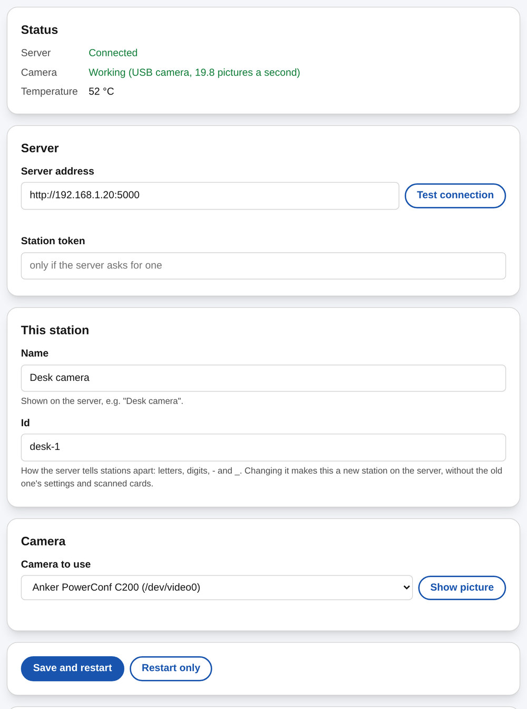

## 2. Reading and matching (the server)

- **OCR first:** a local text reader gets the name, collector number and set code in about
  0.1 s on a GPU (0.7 s on a CPU).
- **A vision AI second,** only when OCR cannot confirm (full-art and borderless cards, a soft
  collector line): Google Gemini, OpenAI, Anthropic Claude, or a self-hosted model through
  Ollama. The prompts can be edited per model and tested; API keys are stored masked and the
  browser can only replace or remove them.
- **Foil detection** from the star / dot next to the set code, combined with which finishes
  each printing exists in (a printing that exists only in foil is known for certain). Where the
  OCR does not read the marker, a small network reads it from the set line (`foil_net.onnx`,
  since 2026-10-20) before the vision AI is asked; measured on 13 recent sets only, never tried
  on a Pi or in the Android app.
- **Tokens and emblems** are in the card data (since 2026-10-20) and are matched by the `T 0001` their
  collector line prints, which Scryfall files under the token set (`tfra`); written from one scan session's
  pictures and tests on synthetic data, **never run on a real card-data download yet** (it needs a card-data
  update, and the picture index's button for their pictures).
- **The exact printing** from set code + collector number, checked against the name, in a
  local copy of Scryfall's card data, which also gives prices, images and finishes. Name
  matching tolerates misreads, accents, flavor names and shortened legendary names.
- **The vision AI is the last step** (`reading.mode: evidence`, the default since 2026-10-20; the AI
  was there because OCR once read poorly): for a card the full-card OCR cannot confirm, the
  fingerprint of the picture and the strip's collector number and set decide first, the AI is asked
  only when they do not, and its answer is checked against the picture. On the experiment's
  pictures: 59% of the AI-read cards decided by themselves with the strip's confirmation (81% if the
  picture alone may also add, which is off by default), none wrong. Needs the picture index
  (Settings > Storage; without it cards are read as before); a switch in Settings > Card reading
  turns it off, and it takes effect on the next card. **Not yet run on live scans** (rehearsed on a
  copy of the real data).
- **A printing check in shadow mode** (since 2026-10-20): a 96-byte fingerprint of every
  printing's picture (Settings > Storage > Picture index, or `scripts/build_image_index.py`; about 15 MB; after a card database update the same button downloads only the new pictures) lets the server ask whether
  a capture looks like the printing it just added - the Secret Lair cards that print another
  printing's set and number, and cards the AI misread. For now it only writes down where it
  disagrees (`python scripts/printing_check_report.py`) and changes nothing; without the index it
  does nothing. For the cards the vision AI handles it also writes down what the picture and the
  collector line alone would have answered, beside the AI's answer: the evidence for dropping the AI
  later (on the experiment's pictures: 84% added by themselves, none wrong, 16% would go to
  review). Thresholds from 20 known-wrong labels; deployed on the server on 2026-10-20 but not yet judged on live scans; never tried on a Pi or the Android app.
- **Added or reviewed:** a confirmed printing goes straight into the *scanned cards* (with an
  Undo); anything uncertain waits in that camera's **review queue**, where you search, choose
  the printing, finish and quantity, and add it. With the image index the review also shows the five printings the capture's picture looks like, to pick from, and says when the foil marker was not read.
  Scanning goes on meanwhile.
- **Send back to review:** a button on any entry of the collection or the scanned cards sends
  one copy back to the review queue with its photo, to find the right printing.
- **Manual search** of the card data, by name, set and number, with all printings of a card.
- **Card data updates** (download and safe replacement) and a check for new data.
- **Sounds:** a beep per capture and a sound when a card is added; the volume and each sound
  can be changed.

*The review queue: the capture beside the card the program suggests, with the printing to correct.
This one was sent back from the collection.*

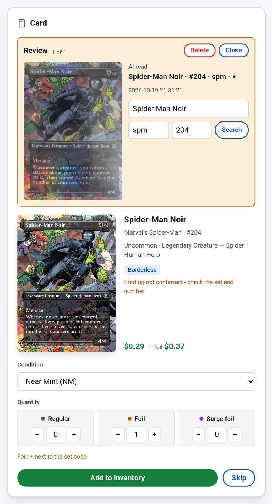

*Settings, card reading: OCR first, and which vision AI to ask when OCR is not sure.*

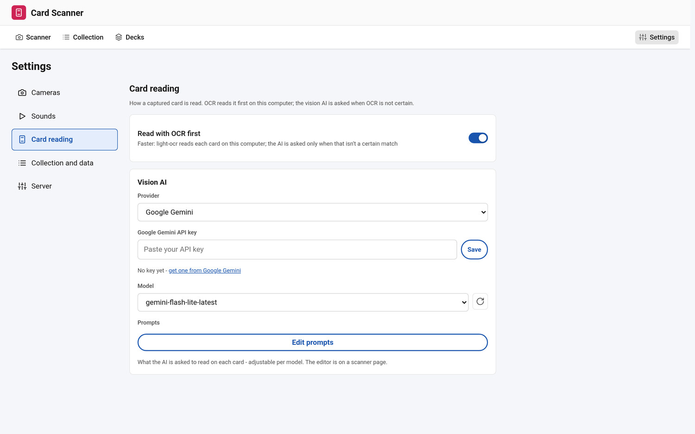

## 3. The collection

- **Scanned cards** wait until you press *Add to collection* (for one camera or all, with a
  location). Locations, tags, condition and finish are kept per entry; the scanned list can be
  narrowed to one camera.
- **Browse and edit:** a list or a grid of card images; filters (colours, type, rarity, set,
  finish, location, tags, price range, added when, not in a deck) and a search language
  (`set:HOB`, `name:ring`, `type:elf`, `qty:>4`, `loc:"Binder 2"`, `trade:jo`, a minus to leave
  out); sorting; bulk edits; changing an entry's printing, finish or condition; splitting and
  merging entries that become the same.
- **The photo of every card** is kept with its entry, opens large, and can be kept at a chosen
  size; old received pictures are cleaned up on a schedule or on demand, and large copies can
  be compressed.
- **Statistics:** totals and value, and breakdowns by colour, type, rarity, finish, set and
  location, with the most valuable cards.
- **Import and export:** the app's own CSV, Moxfield (import and export), and ManaBox
  (import - written from the format's known layout, **never tried on a real ManaBox file**).
  Exports can be limited to what is ticked or filtered.
- **Backups** of the collection, the scanned cards and the decks: automatic, on demand,
  restored, downloaded, uploaded, plus a full snapshot of every database file and picture.
  Restoring one first makes a backup of what is there.
- **Safe by design:** a change is whole or not at all; moving cards to the collection survives
  a crash; the database enforces that an entry never has zero copies.

*The collection as a list, with the photo of each card beside its entry.*

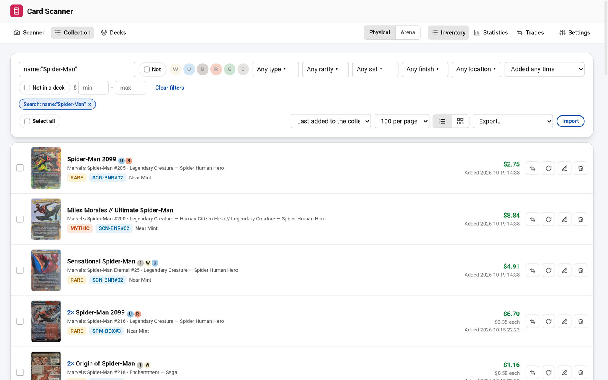

*The same collection as card images (a card set aside for a trade is marked).*

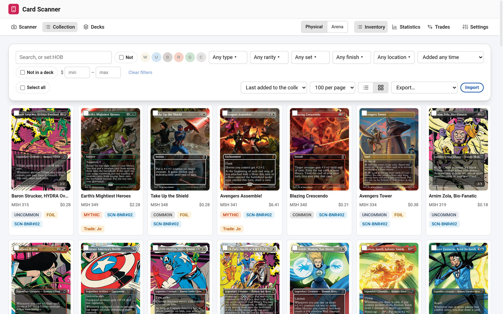

*Statistics, here by number of cards (the page can show value too).*

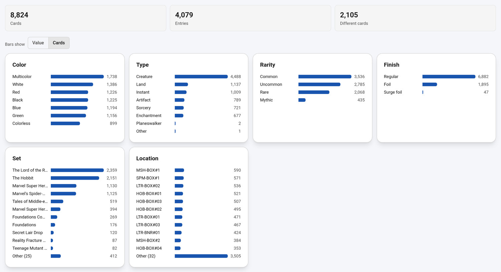

## 4. Decks

- **A deck builder** for 12 formats: Commander, Standard, Pioneer, Modern, Legacy, Vintage,
  Pauper, Historic, Timeless, Alchemy, Brawl and Standard Brawl.
- **Checks:** deck size, copy limits, sideboard size, banned and not legal cards, and a
  commander's colour identity - each shown as an error or a warning.
- **Ownership:** how much of each deck you own, copies already used by another deck, and which
  cards of the collection are in no deck.
- **Views:** columns or stacks; by type, cost or colour; a mana curve, card types and mana
  symbols; the deck's cover card; duplicate, rename, delete.
- **Decklists:** paste a list to import it; export a deck as text, as a **buy list of the copies
  you do not own**, or in the form MTG Arena's Import button takes.
- **Ideas from other sites** (they need the internet and are kept apart from scanning):
  EDHREC suggestions for a commander, popular decks (MTGJSON, Archidekt, Moxfield), the
  preconstructed decks, *What can I build?* from your collection, and a list of spare cards
  that no deck uses and EDHREC does not suggest.

*The deck list.*

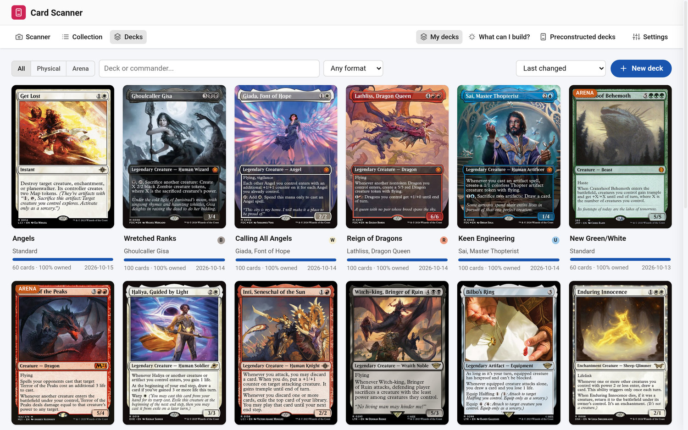

*One deck: checks, mana curve, card types, and the cards by type.*

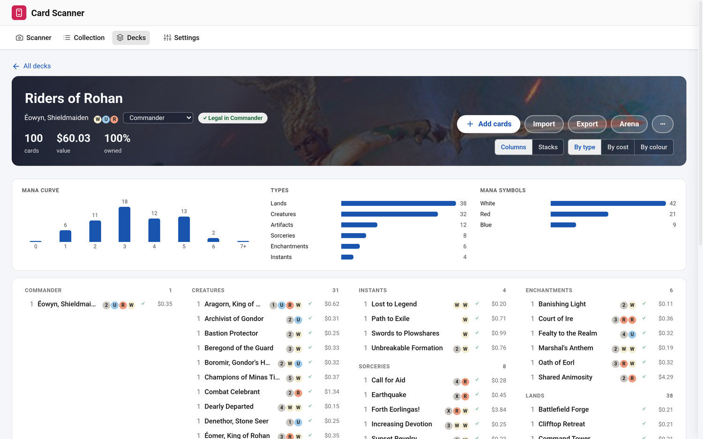

## 5. Trades, other people's collections and a buy list

- **Trades:** set cards aside for a named trade (they stay in your collection, marked, until
  you confirm it), change the copies, rename, cancel, or confirm (the copies leave); a history of
  confirmed trades; each trade can be exported.
- **Other people's collections:** import a collection file (the app's CSV, Moxfield or ManaBox)
  under a person's name into a database of its own, browse and search it, and delete it when you
  are done. It never touches your collection or its backups.
- **Receiving:** put cards of such a collection into a trade as what the trade *receives*,
  with both sides and both values shown. This is a record only: confirming a trade adds nothing
  to your collection.
- **A buy list:** cards of an imported collection grouped by seller, copies capped at what the
  seller has, totals, and an export (all or one seller).

*An open trade: the cards given and the cards received from someone else's collection.*

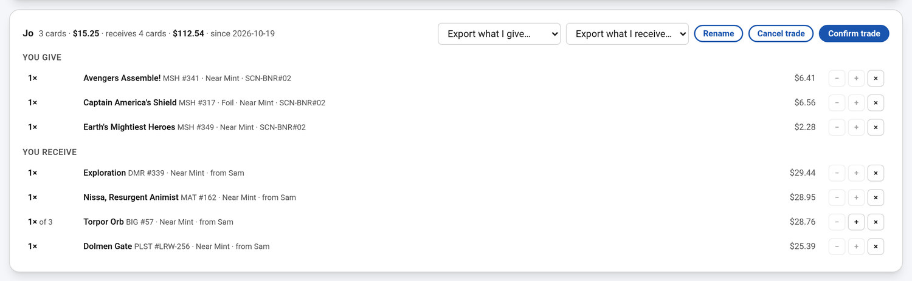

*Browsing an imported collection: Receive puts a card in a trade, Buy puts it on the buy list.*

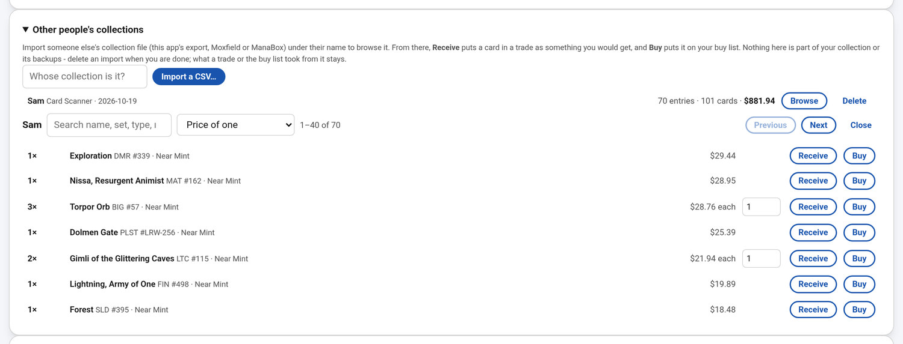

*The buy list, grouped by seller.*

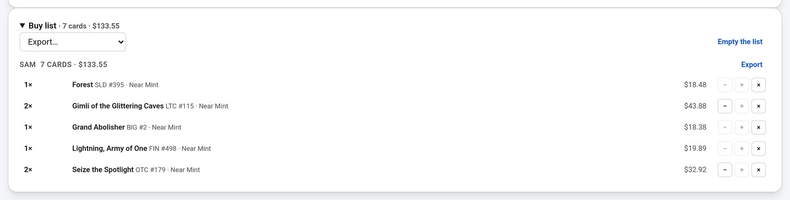

## 6. MTG Arena

- **Your Arena collection** read from an exporter's files and kept as a read-only copy beside
  the paper collection, with the wildcards you would need for a deck.
- **Arena decks** imported next to the paper ones (and replaced by the next import), checked
  against what you own in Arena.
- **A decklist for Arena's Import button** from any deck.

*The digital (MTG Arena) collection, kept beside the paper one.*

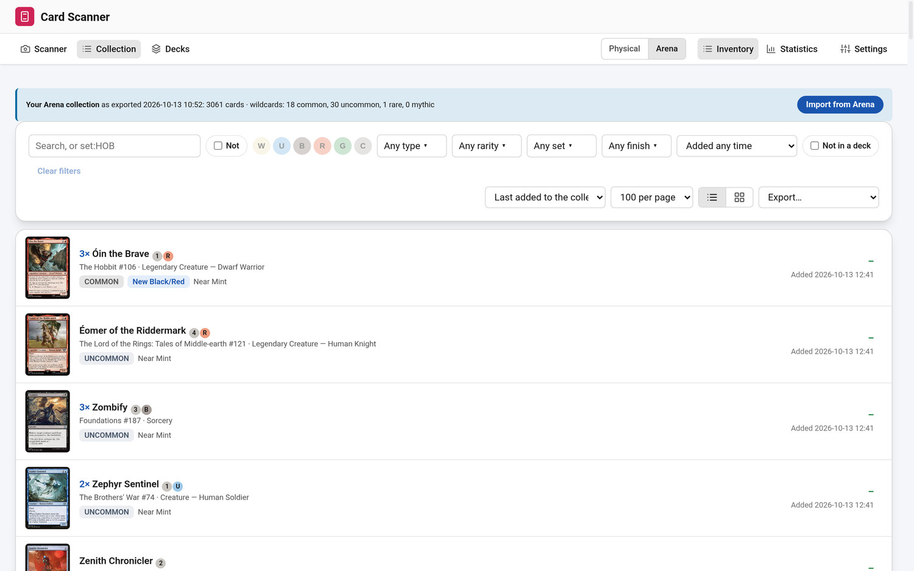

## 7. Running it, keeping it safe

- **Images and installs:** Docker images for the server (with an NVIDIA GPU option), for a
  camera station, and for a Raspberry Pi camera; scripts and systemd units for a machine that
  is both; a desktop program (AppImage) that starts the server and a station together.
- **Settings page** (cameras, sounds, card reading, collection and data, server): choose a
  camera and its scan location, refocus rules, the vision AI and prompts, backups, card data,
  storage, restart / quit, network access, debug mode.
- **An optional settings password** guards the AI keys, restart / quit, network access, debug
  mode and restoring or deleting backups.
- **Requests from other web pages are refused;** the pages load everything from the server
  (nothing from a CDN) so a network without internet still works.
- **An MCP server** lets an AI assistant read your decks and collection, check a deck, find what
  is missing, and propose changes. It is read-only: it changes nothing.
- **Tools for the detector and the speed:** a debug trace of slow or doubtful captures,
  scripts to label frames, train and score the corner network, and to benchmark the database
  and the station.
- **Logs** per area (app, AI, database, scanned cards, OCR) in the data folder, and a station's
  own console log.

## Limits and what was not tried

- Magic only; the server needs Linux with Docker (or a Python environment), and the vision AI
  needs an API key or a local Ollama model.
- ManaBox import, importing the Moxfield export at Moxfield, and an Arena deck with a
  commander or a sideboard were never tried on real files (see the README and TEST_CASES.md).
- The browser pages were tried in a headless browser and on the author's own machines, not on
  every device; the Android app has been run, not audited by a human.
- This project was written entirely by an AI coding assistant, directed by its author - see
  *How this project was built* in the [README](../README.md).
